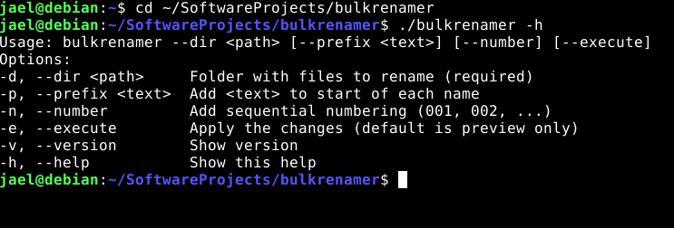
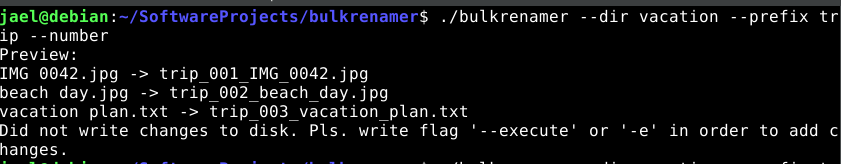
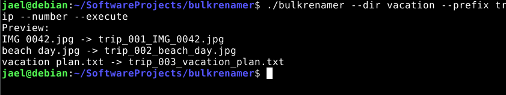
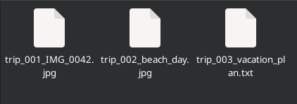
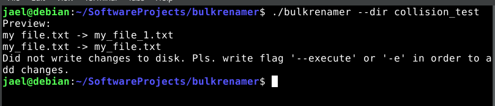

# Bulk Renamer

A simple CLI bulk file renamer written in C++.

Bulk Renamer help you rename multiple files at once, it only shows a preview of the old names and the new names, nothing in disk is changed
until you add `--execute`.

## Features

- Renames the files in a folder you choose
- Skips hidden items where the name start with dot and subfolders
- Replaces spaces in names with underscores
- Optionally add custom prefix
- Optionally add sequential numbering, starting at `001`
- Handles file name collisions
- Previews first, apply only with `--execute`

## Build

You need a C++17 or newer compiler. It has tested with g++ on Linux using C++17 and C++20.
```bash
g++ -std=c++20 main.cpp -o bulkrenamer
```
It makes an executable called 'bulkrenamer'. You can name it however you like.

## Usage

The image show how to use it:



New names are built on this order: prefix + number + original name (space replace with underscore) + extension

**Examples:**
Imagine folder vacation have 3 files named: `beach day.jpg`, `IMG 0042.jpg`, and `vacation plan.txt`.

**Preview:**



Apply the changes using `--execute`





**Name collisions:**
If new name already exist, a counter is added instead of overwrite to prevent data loss.



## Good To Know
- Only files directly inside the folder is renamed. Subfolders is not search.
- If a rename fails during process, Bulk Renamer stops and reports how many files are already renamed. It does not undo change.
- Numbers greater than 999 become four digits (1000_...).
- The collision check is case sensitive, so on case insensitive file system, names that differ only by letter case could still error.
- It has been developed and tested on Linux.

**Tip:** always read the preview before using `--execute`.

## License

This project is licensed under GNU General Public License version 3.0. Please see the [LICENSE](LICENSE) file for license details.

## Thank You
Thank you for checking out Bulk Renamer. I hope you find this cool! I don't know where is to receive feedback, or suggestions, but they are welcome.
